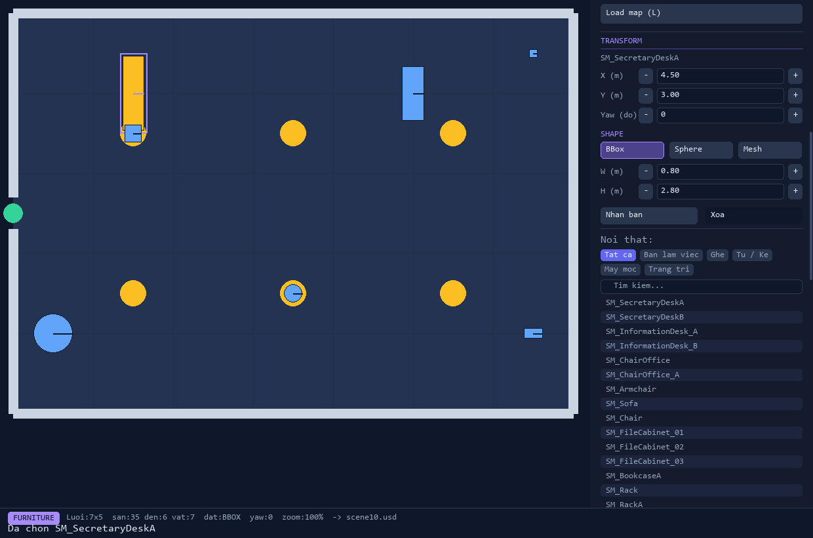
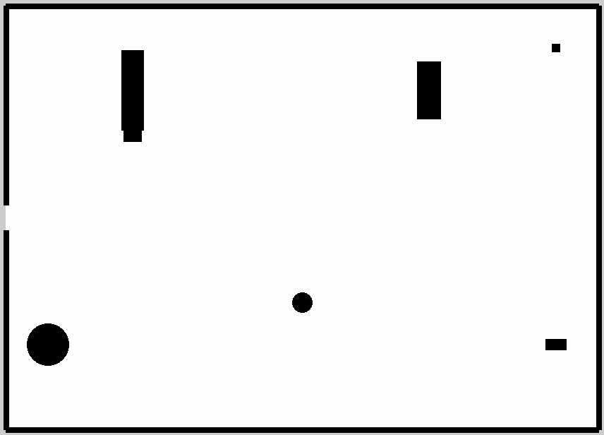

<div align="center">

[English](README.md) · **Tiếng Việt**

# 🗺️ Isaac Scene Builder

### Vẽ mặt bằng 2D → scene 3D USD cho **NVIDIA Isaac Sim** + bản đồ **BEV** cho robot điều hướng

Một trình biên tập lưới đơn giản: bạn tô sàn, kéo tường, thả nội thất —
phần mềm dựng ra scene USD và bản đồ occupancy (nhìn từ trên xuống) chuẩn ROS.
**Không cần biết USD hay lập trình.**

<br>


<br>



<sub>Giao diện thật — phòng có tường (trắng), đèn trần (vàng), nội thất (xanh); vật đang chọn có viền tím và bảng chỉnh toạ độ/kích thước bên phải.</sub>

</div>

<br>

## 🔄 Quy trình — ba bước, từ nét vẽ đến bản đồ cho robot

> Mỗi ô lưới = **3×3 mét**. Bạn chỉ làm việc ở bước 1; hai bước sau là một cú bấm phím.

| Bước | Bạn làm | Kết quả |
|:---:|---|---|
| **01 ✏️** | Thiết kế mặt bằng 2D — tô sàn, kéo tường, thả nội thất | Bản đồ lưới trực quan |
| **02 🧊** | Bấm **`S`** | `scene.usd` — scene 3D mở thẳng trong Isaac Sim, tường khít lưới |
| **03 🗺️** | Bấm **`B`** | Bản đồ BEV trắng-đen + `CSV/SVG/PGM/YAML` chuẩn ROS `map_server` |

<br>

## ✨ Tính năng

| | |
|---|---|
| 🧱 **3 công cụ vẽ**<br>`Floor` tô sàn · `Wall` kéo tường · `Furniture` thả nội thất. Kéo-thả để vẽ cả vùng / đoạn dài. | 🎛️ **Bảng chỉnh chính xác**<br>Click một vật để sửa toạ độ X/Y, góc xoay, dạng khối — gõ số trực tiếp hoặc bấm `−` `+`. |
| ⬛ **3 dạng hình khối**<br>**BBox** (hộp) · **Sphere** (tròn) · **Mesh** (hình chiếu thật). Chọn dạng nào, đặt xuống auto dạng đó. | 🪑 **68 mẫu nội thất**<br>Bàn, ghế, sofa, tủ, cây… gồm cả asset chính hãng **NVIDIA**. Tìm theo tên & lọc theo danh mục. |
| ↩️ **Undo/Redo & Zoom**<br>`Ctrl+Z`/`Ctrl+Y` (50 bước) · `Ctrl`+lăn để zoom · giữ nút giữa để kéo tầm nhìn. | 📤 **Xuất gọn theo scene**<br>Mỗi scene một thư mục riêng trong `output/` — đủ USD, BEV và metadata, sẵn sàng đưa cho robot. |

<br>

## 🖼️ Bản đồ BEV — thứ robot thực sự đọc

<div align="center">



</div>

Nhìn từ trên xuống, mỗi điểm ảnh mang một trạng thái — đây chính là *occupancy grid* mà ROS dùng để định tuyến. Tỉ lệ metric chuẩn (**1 px = 2.5 cm**), kèm `.yaml` để nạp thẳng vào `map_server`.

| Màu | Giá trị | Ý nghĩa |
|:---:|:---:|---|
| ⬜ Trắng | `254` | **Đi được** (free space) |
| ⬛ Đen | `0` | **Chiếm dụng** — tường + nội thất |
| ◾ Xám | `205` | **Chưa biết** / ngoài phòng (unknown) |

<br>

## 🚀 Bắt đầu nhanh

> Cần Python 3.12+ và `pygame`, `Pillow`, `numpy` — cài bằng `pip install -r requirements.txt`.

**1 · Mở trình biên tập**
```bash
editor.bat                 # Windows: bấm đúp
# hoặc
python src/scene_editor.py
```

**2 · Vẽ phòng**
```text
1  Floor      → click / kéo tô sàn
W             → tự sinh tường bao quanh
2  Wall       → click cạnh để đổi tường / cửa / cửa sổ / kính / lối mở,
                hoặc chọn EDGE TYPE ở panel rồi kéo dọc hàng;  O = mở/đóng cửa
4  Style      → tô style phòng (Office / Hospital / Warehouse / Home) lên sàn
3  Furniture  → chọn ở palette, click đặt  (giữ trái + kéo để di chuyển)
```

Tường được dựng như scene office của NVIDIA: hai tấm panel quay lưng vào nhau (mỗi mặt mang
style của phòng nó quay vào), có bịt đầu tường và góc; cửa có khung + cánh thật (mặc định mở),
cửa sổ và tường kính là module 3 m. Ví dụ: `data/maps/demo_architecture.json`.

**Sinh scene tự động** (`src/map_generator.py`, tất định theo seed)
```bash
python tools/batch_generate_scenes.py --count 20 [--theme office|hospital|warehouse|residential]
                                      [--density 0.12 0.3] [--size 8 6] [--seed 1] [--no-usd]
python tools/check_density_distribution.py [--maps "data/maps/generated/*.json"]
```
- Mặt bằng: hành lang + phòng (văn phòng / bệnh viện), chia phòng BSP có thể khuyết góc (nhà ở),
  sảnh lớn + dãy văn phòng (kho); cửa theo cây khung nối các phòng, cửa chính, cửa sổ, vách kính
  cho phòng họp; style và đèn theo phòng.
- Nội thất theo loại phòng (bàn + ghế, bàn họp + ghế, giường + tủ đầu giường, dãy kệ có lối đi,
  ...) dùng footprint đã đo; mỗi món phải giữ mọi cửa và ≥ 90 % vùng trống tới được với robot đã
  chọn (`--robot`, bán kính footprint + 5 cm). Điểm xuất phát ở cửa chính, mỗi phòng một waypoint.
- Mỗi map: `data/maps/generated/gen_XXXX.json` (mở được bằng editor), BEV + occupancy theo độ cao +
  file Nav2, `.usd` có collider / semantic; `index.csv` + báo cáo mật độ và histogram.

**Đầu ra sẵn sàng cho mô phỏng**
- `.usd`: `PhysicsScene` + collider tĩnh cho sàn, tường, cửa, cửa sổ, kính và mọi mesh nội thất;
  nhãn `UsdSemantics` theo class (`floor`, `wall`, `door`, `window`, `glass_wall`, `ceiling`,
  loại nội thất như `table`, `seating`, `medical`) cho segmentation / bounding box của
  Replicator; điểm xuất phát + waypoint của robot là các marker `/World/Robot`.
- **Công cụ Robot (5):** chọn mẫu robot, click = waypoint, Shift+click = điểm xuất phát, lăn
  chuột = hướng, chuột phải = xoá. Footprint được vẽ đúng tỉ lệ tại điểm xuất phát.
- **Mẫu robot** (`data/robots/<id>.json` + `.svg`, `python tools/import_robots.py`): JetAuto Pro
  và JetBot lấy đường viền từ chính mesh của chúng (`JetRobots/assets/.../jetauto_pro.usd`,
  `jetbot.usd`; navsim chỉ có hình hộp đặt giữa cho JetAuto); TurtleBot3 Burger / Waffle Pi /
  TurtleBot 4 / 4 Lite lấy từ preset navsim. Mẫu robot quyết định độ rộng lối đi khi sinh map,
  `footprint` (bao lồi) /
  `robot_radius` Nav2 trong `<stem>_nav.yaml` và đường viền footprint dưới `/World/Robot/Spawn`
  trong USD.
- **Occupancy theo độ cao:** `python tools/slice_footprints.py [--z 0.05 0.50]` cắt mesh thật của
  từng prop ở độ cao thân robot; xuất BEV sẽ có thêm `<stem>_occ_<z0>-<z1>.pgm/.yaml` (robot thấp
  chui qua gầm bàn; bàn kính chỉ chặn ở chân). Cánh cửa mở là vật cản trên cả hai bản đồ.
- **ROS 2 / Nav2:** hệ toạ độ map của PGM + YAML trùng hệ toạ độ thế giới USD; xuất kèm
  `<stem>_nav.yaml` (vị trí đầu + waypoint) và `follow_waypoints.py` (nav2_simple_commander).
- OpenUSD được nạp từ bộ của Isaac Sim (`C:\isaacsim` hoặc `$ISAACSIM`) khi chưa cài `pxr`, nên
  editor ghi được `.usd` bằng Python thường. Segmentation của Replicator bỏ qua kính trong suốt
  trừ khi bật translucency trong thiết lập của nó.

**3 · Xuất sản phẩm — một phím**
```text
S  →  output/scenes/sceneN.usd     # scene 3D cho Isaac Sim
B  →  output/bev/sceneN/           # bản đồ BEV cho robot (5 định dạng)
```

<br>

## ⌨️ Phím tắt

| Phím | Tác dụng | Phím | Tác dụng |
|:---:|---|:---:|---|
| `1`–`5` | Floor / Wall / Furniture / Style / Robot | `Ctrl+Z` `Ctrl+Y` | Hoàn tác / Phục hồi |
| `O` | Mở / đóng cửa dưới con trỏ | `V` | Mesh: mask / ảnh màu |
| `Tab` | Đổi công cụ | `Ctrl`+lăn | Zoom theo con trỏ |
| `R` | Xoay nội thất 5° | Giữ nút giữa | Kéo tầm nhìn (pan) |
| `W` | Tự sinh tường bao | `S` / `B` | Xuất USD / BEV |
| `C` | Xoá hết | `Ctrl+S` / `L` | Lưu / Nạp bản đồ |
| `+` `-` | Đổi kích thước lưới | `F11` | Toàn màn hình |

<br>

## 📁 Cấu trúc dự án

```
isaac-scene-builder/
├── src/                    # Source code
│   ├── config.py           # Single source of truth (paths, màu, catalog)
│   ├── utils.py            # Helper dùng chung
│   ├── scene_editor.py     # GUI chính (Pygame)
│   ├── scene_builder.py    # Core USD builder
│   ├── bev_export.py       # Xuất BEV (CSV/SVG/PGM/YAML)
│   ├── isaac_bev_capture.py# Chụp ảnh BEV trong Isaac Sim
│   ├── shape_editor.py     # Đo bounding box/sphere thủ công
│   ├── shape_tools.py      # Logic đo shape (Pillow/numpy)
│   ├── build_furniture_shapes.py  # Tự động trích shape
│   └── generate_scene.py   # Sinh scene ngẫu nhiên
├── assets/                 # 3D assets (KHÔNG versioned — xem bên dưới)
│   ├── office/             # Office asset pack
│   └── extra/              # Asset bổ sung (thả vào đây)
├── data/                   # maps/ · props_shapes.json · catalog/
├── output/                 # Sản phẩm: scenes/ · bev/ · mesh_shapes/
├── tests/                  # Test suite (pytest) — 55 tests
└── *.bat                   # Launcher Windows: editor, capture, ...
```

<br>

## 🎨 Thêm asset mới

Palette **tự đăng ký**: chỉ cần thả file `.usd` tự chứa vào `assets/extra/` là nó xuất hiện trong editor.
Để lấy đúng kích thước & hình khối:

```bash
isaacsim\python.bat src/isaac_bev_capture.py <Tên>   # 1. chụp ảnh BEV
python src/build_furniture_shapes.py                 # 2. đo W/H/R + cắt mesh
python src/scene_editor.py                            # 3. có ngay trong palette
```

**Thư viện asset (~260 model tuyển chọn, văn phòng · nhà ở · bệnh viện · kho):**
`python tools/asset_library.py fetch` tải về `assets/library/` (NVIDIA ArchVis / DigitalTwin / Isaac + Poly Haven CC0).

Nguồn tải asset tương thích (NVIDIA Omniverse / SimReady) và chi tiết: xem [`docs/ASSETS.md`](docs/ASSETS.md).

> **Lưu ý về Git:** `assets/office/` (~710 MB) và `assets/extra/*.usd` **không** được versioned để repo gọn nhẹ.
> Sau khi clone, chạy `fetch_assets.bat` (hoặc `python tools/fetch_office_assets.py`) để tải Office pack
> từ server asset Isaac Sim công khai của NVIDIA về `assets/office/`; asset bổ sung thì tự đặt vào `assets/extra/`. Dữ liệu shape (`data/props_shapes.json`) & bản đồ (`data/maps/`) thì có sẵn.

<br>

## 🧪 Test

```bash
pytest              # 55 passed
```

<div align="center">
<br>
<sub>2D grid → USD 3D → BEV (ROS) · 68 nội thất · 5 định dạng xuất · 55/55 test</sub>
</div>
